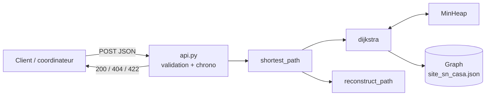
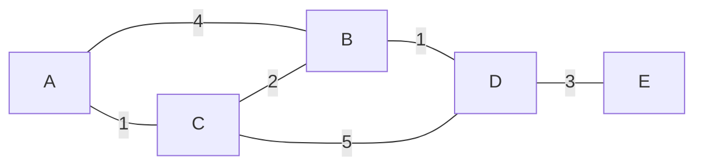
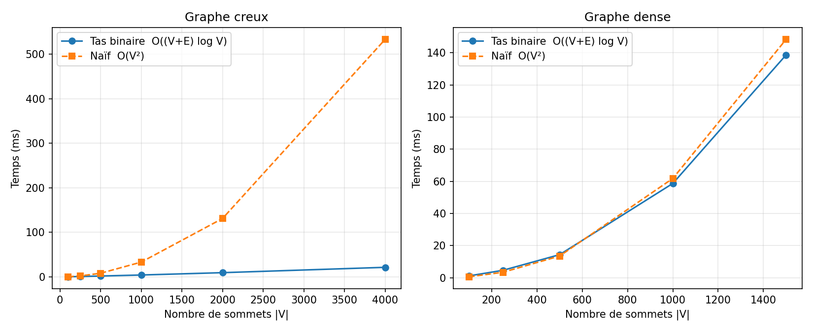

# 🐝 QueenBee — Itinéraire d'urgence (Dijkstra)

> **Évaluation pratique d'algorithmique — Mastère 1, spécialité Développement / DevOps (INGETIS / ITIS)**
> Projet fil rouge QueenBee : réseau apicole connecté de 400 ruches sur 8 sites (Sénégal, Côte d'Ivoire, Cameroun).

Quand une ruche déclenche une **alerte critique** (chute brutale de poids, risque d'essaimage, anomalie thermique), le coordinateur régional doit s'y rendre au plus vite. Ce projet calcule **l'itinéraire le plus rapide** sur le réseau de pistes du site et l'expose comme **endpoint REST** du backend QueenBee (cas d'usage UC-C01 du cahier des charges).

Contraintes du sujet, toutes respectées :
- ✅ Dijkstra avec une **file de priorité (tas binaire) codée à la main**, sans `heapq` ni bibliothèque de graphes (NetworkX, etc.)
- ✅ Reconstitution du **chemin complet** et du **coût total**
- ✅ Exposition en **endpoint REST** : `POST /api/v1/routing/emergency-path`
- ✅ **Tests unitaires** sur les cas normaux et les cas limites (41 tests)
- ✅ **Analyse de complexité** O((V+E) log V) et **benchmark** contre la version naïve O(V²)

---

## Sommaire

1. [Démarrage rapide](#1-démarrage-rapide)
2. [Structure du projet](#2-structure-du-projet)
3. [La démarche : comment le projet a été construit](#3-la-démarche--comment-le-projet-a-été-construit)
4. [Modélisation du site](#4-modélisation-du-site)
5. [Dijkstra expliqué](#5-dijkstra-expliqué)
6. [Le tas binaire expliqué](#6-le-tas-binaire-expliqué)
7. [Le code, fichier par fichier](#7-le-code-fichier-par-fichier)
8. [L'API REST](#8-lapi-rest)
9. [Analyse de complexité](#9-analyse-de-complexité)
10. [Benchmark](#10-benchmark)
11. [Les tests](#11-les-tests)
12. [Mini-cours de Python pour lire le code](#12-mini-cours-de-python-pour-lire-le-code)
13. [Questions probables du jury](#13-questions-probables-du-jury)

---

## 1. Démarrage rapide

Prérequis : **Python 3.10 ou plus récent**.

```powershell
# 1. Créer un environnement virtuel (dossier .venv, isolé du reste de la machine)
python -m venv .venv

# 2. Installer les dépendances
.\.venv\Scripts\python -m pip install -r requirements.txt
```

> Sous Linux ou macOS, remplacez `.\.venv\Scripts\python` par `.venv/bin/python`.

| Action | Commande |
|---|---|
| Lancer les tests | `.\.venv\Scripts\python -m pytest -v` |
| Démarrer l'API | `.\.venv\Scripts\python -m uvicorn queenbee_routing.api:app --reload` |
| Documentation interactive (Swagger) | ouvrir http://127.0.0.1:8000/docs |
| Lancer le benchmark | `.\.venv\Scripts\python -m benchmark.benchmark` |
| Régénérer le site | `.\.venv\Scripts\python -m queenbee_routing.generator` |

**Exemple d'appel :**

```http
POST /api/v1/routing/emergency-path
Content-Type: application/json

{ "start_id": "COORD-SN-CASA", "hive_id": "SN-CASA-014" }
```

```json
{
  "start_id": "COORD-SN-CASA",
  "hive_id": "SN-CASA-014",
  "total_cost_min": 47.5,
  "path": ["COORD-SN-CASA", "X-07", "X-24", "X-25", "SN-CASA-013", "SN-CASA-022", "SN-CASA-014"],
  "steps": 6,
  "computation_time_ms": 0.2571
}
```

---

## 2. Structure du projet

```
.
├── queenbee_routing/          # Le code de l'application
│   ├── min_heap.py            # Tas binaire minimum (codé à la main)
│   ├── graph.py               # Graphe pondéré en listes d'adjacence
│   ├── dijkstra.py            # Dijkstra avec tas + reconstruction du chemin
│   ├── dijkstra_naive.py      # Dijkstra naïf O(V²), pour comparer
│   ├── generator.py           # Génération du site SN-CASA et des graphes de benchmark
│   └── api.py                 # API REST FastAPI
├── data/
│   └── site_sn_casa.json      # Réseau de pistes du site (76 sommets, 121 arêtes)
├── tests/                     # Tests unitaires pytest
│   ├── test_min_heap.py
│   ├── test_dijkstra.py
│   └── test_api.py
├── benchmark/
│   ├── benchmark.py           # Mesure tas vs naïf
│   ├── results.csv            # Résultats bruts
│   └── benchmark.png          # Graphique
├── requirements.txt           # Dépendances Python
└── pytest.ini                 # Configuration des tests
```

L'enchaînement lors d'un appel à l'API :



---

## 3. La démarche : comment le projet a été construit

| Étape | Ce qu'on a fait | Pourquoi |
|---|---|---|
| 1. Lire le sujet | Lister les attendus : Dijkstra, tas binaire obligatoire, endpoint REST, tests, complexité, benchmark | Ne coder que ce qui est évalué. Le cahier des charges sert de contexte, pas de liste de tâches |
| 2. Modéliser le problème | Sommets = base, carrefours, ruches. Arêtes = pistes. Poids = **temps de trajet en minutes** | En urgence, on veut arriver le plus **vite**, pas parcourir le moins de kilomètres |
| 3. Choisir la structure du graphe | **Listes d'adjacence** | Un réseau de pistes est **creux** : chaque point a 2 à 5 voisins. Une matrice V×V gaspillerait de la mémoire et du temps |
| 4. Coder le tas binaire | `min_heap.py` | Le sujet interdit les structures toutes faites comme `heapq` |
| 5. Coder Dijkstra | `dijkstra.py`, plus `dijkstra_naive.py` | La version naïve sert de référence pour le benchmark et pour vérifier les résultats dans les tests |
| 6. Générer les données | `generator.py` → `data/site_sn_casa.json` | Le CDC ne fournit pas de réseau de pistes : on le construit à partir de vraies coordonnées de Casamance (CDC §6.5) |
| 7. Exposer l'API | `api.py` avec FastAPI | Le sujet impose un endpoint REST et non un script isolé. FastAPI est recommandé par le CDC (§9.1) |
| 8. Tester | 41 tests `pytest` | Prouver que ça marche, y compris sur les cas limites |
| 9. Mesurer | `benchmark.py` | Confirmer la théorie de la complexité par l'expérience |

---

## 4. Modélisation du site

Le site modélisé est **SN-CASA** (Casamance, Sénégal), l'un des 8 sites du projet.

| Élément | Choix | Justification |
|---|---|---|
| Base du coordinateur | `COORD-SN-CASA` au centre : 12.5833 N, -16.2833 E | Coordonnées de l'exemple du CDC §6.5 |
| Ruches | 50 ruches, `SN-CASA-001` à `SN-CASA-050` | 400 ruches / 8 sites = 50 par site (CDC §1.4). Format d'identifiant du CDC §6.5 |
| Carrefours | 25 carrefours, `X-01` à `X-25` | Croisements du réseau de pistes |
| Zone | Rayon de 6 km autour de la base | Taille réaliste d'un site rucher |
| Types de voies | **route** 50 km/h, **piste** 25 km/h, **sentier** 5 km/h (à pied) | Vitesses moyennes en zone rurale |
| Distance | Distance à vol d'oiseau (formule de **Haversine**) × 1,3 | Une piste n'est jamais en ligne droite |
| Poids d'une arête | distance (km) / vitesse (km/h) × 60, **en minutes** | Le critère d'urgence est le temps |
| Reproductibilité | Graine aléatoire fixe (`seed=42`) | Le même site est regénéré à chaque fois |

Construction du réseau :
1. Chaque carrefour est relié à ses 3 carrefours les plus proches (30 % de routes, 70 % de pistes).
2. Un **parcours en largeur (BFS)** vérifie que tous les carrefours sont reliés. Sinon, on relie le morceau isolé au plus proche.
3. La base rejoint ses 2 carrefours les plus proches par la route.
4. Chaque ruche est reliée à son carrefour le plus proche. Une fois sur deux, elle est aussi reliée à la ruche voisine par un sentier, ce qui crée des chemins alternatifs et des cycles.

Résultat : 76 sommets, 121 arêtes, **toutes les ruches sont accessibles** depuis la base (vérifié par un test).

---

## 5. Dijkstra expliqué

### L'idée

On explore le graphe **du sommet le plus proche au plus éloigné** de la source.

À chaque tour, on prend le sommet non visité qui a la plus petite distance provisoire. Comme tous les poids sont ≥ 0, aucun autre chemin ne pourra l'améliorer plus tard : **sa distance est définitive**.

Ensuite, on **relâche** ses voisins : *passer par lui raccourcit-il le chemin vers ce voisin ?* Si oui, on met à jour la distance du voisin et on note par où on est passé (`prev`).

### Pseudo-code

```
dist[source] = 0 ; prev[source] = rien
tas ← {(0, source)}
tant que le tas n'est pas vide :
    (d, u) ← extraire le minimum du tas
    si u déjà visité : continuer          # entrée périmée
    marquer u visité
    si u = cible : arrêter                 # arrêt anticipé
    pour chaque voisin v de u, avec poids w :
        si d + w < dist[v] :
            dist[v] = d + w ; prev[v] = u
            insérer (d + w, v) dans le tas
```

### Déroulé à la main

C'est le graphe utilisé dans les tests :



Recherche du plus court chemin de **A** vers **E** :

| Tour | Sort du tas | Action | dist après le tour | Contenu du tas |
|---|---|---|---|---|
| 0 | — | initialisation | A=0 | (0,A) |
| 1 | (0,A) | A visité. B : 0+4=4. C : 0+1=1 | A=0, B=4, C=1 | (1,C) (4,B) |
| 2 | (1,C) | C visité. B : 1+2=**3 < 4**, donc amélioré. D : 1+5=6 | B=3, D=6 | (3,B) (4,B) (6,D) |
| 3 | (3,B) | B visité. D : 3+1=**4 < 6**, donc amélioré | D=4 | (4,B) (4,D) (6,D) |
| 4 | (4,B) | **B déjà visité : entrée périmée, ignorée** | — | (4,D) (6,D) |
| 5 | (4,D) | D visité. E : 4+3=7 | E=7 | (6,D) (7,E) |
| 6 | (6,D) | périmée, ignorée | — | (7,E) |
| 7 | (7,E) | **E = cible, on s'arrête** | | |

Les tours 4 et 5 peuvent être inversés, car les deux entrées ont la même priorité (4). Le résultat ne change pas.

Pour retrouver le chemin, on remonte `prev` depuis la cible : E ← D ← B ← C ← A, puis on inverse la liste. Chemin : **A → C → B → D → E, coût 7**.

On remarque que le chemin « direct » A → B → D → E coûte 8. Le détour par C est meilleur, et c'est exactement ce que Dijkstra trouve.

### Notions clés à savoir nommer

| Notion | Explication |
|---|---|
| **Relaxation** | Mettre à jour `dist[v]` si passer par `u` est plus court |
| **Suppression paresseuse** (*lazy deletion*) | Quand la distance d'un sommet s'améliore, on n'efface pas son ancienne entrée dans le tas : on en ajoute une nouvelle. Les anciennes sont ignorées quand elles ressortent (`if u in visited: continue`). C'est plus simple qu'une opération `decrease-key`, qui oblige à connaître la position de chaque sommet dans le tas |
| **Arrêt anticipé** | Dès que la cible sort du tas, sa distance est définitive, donc on s'arrête. Pour une urgence, inutile de calculer le chemin vers les 75 autres sommets |
| **Poids négatifs interdits** | Un sommet « définitif » pourrait encore être amélioré par une arête négative découverte plus tard. Le graphe refuse donc tout poids négatif (`ValueError`) |

---

## 6. Le tas binaire expliqué

Un **tas binaire minimum** est un arbre binaire presque complet où **chaque parent est plus petit que ses enfants**. Le minimum est donc toujours à la racine.

On le range dans une **simple liste**, sans pointeurs. Pour l'élément d'indice `i` :

| Relation | Indice |
|---|---|
| Parent | `(i - 1) // 2` |
| Enfant gauche | `2 * i + 1` |
| Enfant droit | `2 * i + 2` |

```
            1               liste : [1, 3, 2, 7, 4]
          /   \             indice : 0  1  2  3  4
         3     2
        / \
       7   4
```

| Opération | Fonctionnement | Coût |
|---|---|---|
| `push(p, v)` | On ajoute l'élément à la fin de la liste, puis on le fait **remonter** (`_sift_up`) en l'échangeant avec son parent tant qu'il est plus petit | O(log n) |
| `pop()` | On échange la racine avec le dernier élément, on retire ce dernier (c'est l'ancien minimum), puis on fait **redescendre** (`_sift_down`) la nouvelle racine en l'échangeant avec son plus petit enfant | O(log n) |
| `peek()` | On lit la racine | O(1) |

**Pourquoi O(log n) ?** Un arbre binaire presque complet de n éléments a une hauteur de ⌊log₂ n⌋. Remonter ou descendre parcourt au plus une branche, donc au plus log₂ n échanges.

Dans Dijkstra, chaque case du tas contient un couple `(distance, sommet)`, et le tas est ordonné par la distance.

---

## 7. Le code, fichier par fichier

| Fichier | Rôle | Points à savoir expliquer |
|---|---|---|
| [`min_heap.py`](queenbee_routing/min_heap.py) | Tas binaire | Indices parent/enfants, `_sift_up` après `push`, `_sift_down` après `pop`, l'échange racine ↔ dernier dans `pop` |
| [`graph.py`](queenbee_routing/graph.py) | Graphe en listes d'adjacence | Pourquoi des listes d'adjacence, refus des poids négatifs, chargement JSON |
| [`dijkstra.py`](queenbee_routing/dijkstra.py) | L'algorithme | `dist`, `prev`, `visited`, relaxation, suppression paresseuse, arrêt anticipé, `reconstruct_path` |
| [`dijkstra_naive.py`](queenbee_routing/dijkstra_naive.py) | Version O(V²) | La recherche linéaire du minimum à chaque tour |
| [`generator.py`](queenbee_routing/generator.py) | Données | Haversine, types de voies, connexité garantie par BFS |
| [`api.py`](queenbee_routing/api.py) | API REST | Modèles Pydantic, codes 200/404/422, chronométrage avec `perf_counter` |

Représentation du graphe en mémoire (listes d'adjacence) :

```python
adjacency = {
    "A": [("B", 4), ("C", 1)],   # depuis A : vers B en 4 min, vers C en 1 min
    "B": [("A", 4), ("C", 2), ("D", 1)],
    ...
}
```

---

## 8. L'API REST

### `POST /api/v1/routing/emergency-path`

**Entrée :**

| Champ | Type | Description |
|---|---|---|
| `start_id` | texte | Point de départ du coordinateur, par exemple `COORD-SN-CASA` |
| `hive_id` | texte | Ruche en alerte critique, par exemple `SN-CASA-014` |

**Sortie :**

| Champ | Type | Description |
|---|---|---|
| `total_cost_min` | nombre | Temps de trajet total, en minutes |
| `path` | liste | Points de passage dans l'ordre, du départ à la ruche |
| `steps` | entier | Nombre de tronçons parcourus |
| `computation_time_ms` | nombre | Temps d'exécution de l'algorithme seul, sans le réseau ni la conversion JSON |

**Codes de réponse :**

| Code | Quand |
|---|---|
| `200` | Chemin trouvé |
| `404` | `start_id` ou `hive_id` n'existe pas |
| `422` | La ruche est inaccessible, la cible n'est pas une ruche, ou le JSON est incomplet |

### Autres endpoints

| Endpoint | Rôle |
|---|---|
| `GET /health` | État du service et taille du graphe chargé |
| `GET /api/v1/routing/nodes?type=ruche` | Liste des sommets, filtrables par type (`base`, `carrefour`, `ruche`) |

Le fichier de graphe chargé peut être changé avec la variable d'environnement `QUEENBEE_GRAPH_FILE`.

---

## 9. Analyse de complexité

Notations : **V** = nombre de sommets, **E** = nombre d'arêtes.

### Version avec tas binaire : O((V + E) log V)

1. **Chaque sommet est visité une seule fois** grâce à l'ensemble `visited`. Lors de sa visite, on parcourt sa liste de voisins. Au total, toutes les listes sont parcourues une fois : **O(V + E)**, hors opérations sur le tas.
2. **Nombre de `push`** : un `push` n'a lieu que lors d'une relaxation réussie. Chaque arête est examinée au plus une fois par extrémité, donc il y a au plus **2E + 1** `push` (le +1 est la source).
3. **Nombre de `pop`** : on ne peut pas retirer plus que ce qu'on a ajouté, donc au plus **2E + 1** `pop`.
4. **Coût d'une opération** : le tas contient n ≤ 2E + 1 éléments, et `push`/`pop` coûtent O(log n). Comme E ≤ V², on a log n ≤ log(2V² + 1) = O(2 log V) = **O(log V)**.
5. **Total** : O(V + E) + O(E log V) = **O((V + E) log V)**.

### Version naïve : O(V²)

- Il y a V tours. À chaque tour, la recherche du minimum parcourt les V sommets, soit **O(V²)** en tout.
- Les relaxations coûtent O(E) en tout, et E ≤ V².
- Total : O(V² + E) = **O(V²)**.

### Laquelle choisir ? Cela dépend de la densité du graphe

| Graphe | E | Avec tas | Naïf | Gagnant |
|---|---|---|---|---|
| Creux (réseau de pistes) | ≈ V | O(V log V) | O(V²) | **Tas** |
| Dense | ≈ V² | O(V² log V) | O(V²) | **Naïf** |

La frontière se situe vers E ≈ V² / log V. Un réseau de pistes est **creux**, donc le tas binaire est le bon choix pour QueenBee.

**Mémoire** : O(V + E) pour le graphe, et O(E) pour le tas avec la suppression paresseuse.

---

## 10. Benchmark

Méthode (`benchmark/benchmark.py`) :
- deux familles de graphes aléatoires connexes, avec des poids entiers entre 1 et 100 :
  - **creux** : E ≈ 2V, comme un réseau de pistes ;
  - **denses** : chaque paire de sommets est reliée avec une probabilité de 0,5, soit E ≈ V²/4 ;
- calcul de toutes les distances depuis le sommet 0 ;
- on garde le **meilleur temps sur 3 exécutions**, pour limiter le bruit de la machine.



| Type | V | E | Tas (ms) | Naïf (ms) | Naïf / Tas |
|---|---|---|---|---|---|
| creux | 100 | 200 | 0,31 | 0,39 | 1,2 |
| creux | 500 | 1 000 | 2,0 | 8,2 | 4,1 |
| creux | 1 000 | 2 000 | 4,3 | 33,2 | 7,8 |
| creux | 2 000 | 4 000 | 9,5 | 131,1 | 13,8 |
| creux | 4 000 | 8 000 | 21,5 | 533,1 | **24,8** |
| dense | 100 | 2 519 | 1,12 | 0,56 | **0,5** |
| dense | 500 | 62 738 | 14,3 | 13,5 | 0,94 |
| dense | 1 000 | 250 577 | 58,7 | 61,8 | 1,05 |
| dense | 1 500 | 563 258 | 138,7 | 148,4 | 1,07 |

Les résultats exacts varient selon la machine. Les données brutes sont dans `benchmark/results.csv`.

### Interprétation

- **Graphe creux** : quand V est multiplié par 4 (de 1 000 à 4 000), le temps du naïf est multiplié par 16, ce qui correspond à V². Celui du tas n'est multiplié que par 5, ce qui correspond à V log V. L'écart grandit avec la taille.
- **Graphe dense** : le naïf est plus rapide ou à égalité, comme le prévoit la théorie. Le surcoût en log V du tas n'est pas rentable quand presque toutes les paires sont reliées.
- **Sur le vrai site** (76 sommets), le calcul prend environ 0,25 ms. C'est très loin de la cible de 500 ms pour le temps de réponse de l'API centrale (CDC §8.1).

---

## 11. Les tests

41 tests, lancés avec `.\.venv\Scripts\python -m pytest -v`.

| Catégorie | Ce qui est vérifié |
|---|---|
| **Tas** | Sortie dans l'ordre croissant (500 valeurs aléatoires), `peek` ne retire rien, priorités égales conservées, `pop` sur un tas vide lève une erreur |
| **Cas normaux** | Chemin calculé à la main (le détour plus court que le « direct »), toutes les distances depuis la source, arête à sens unique |
| **Cas limites** | Source = cible (coût 0), **graphe non connexe** (cible inaccessible), sommet inconnu en source ou en cible, sommet isolé, **cycle**, chemins de même coût, arête de poids 0, arêtes en double, **poids négatif refusé** |
| **Validation croisée** | Sur 10 graphes aléatoires, creux et denses : les versions tas et naïve donnent exactement les mêmes distances, et chaque chemin renvoyé est valide (arêtes existantes, somme des poids = coût annoncé) |
| **API** | Réponse 200 avec le bon JSON, 404 pour un sommet inconnu, 422 pour une ruche inaccessible, une cible qui n'est pas une ruche ou un champ manquant, liste des ruches, toutes les ruches du vrai site atteignables |

La plupart des tests de Dijkstra tournent **sur les deux versions** de l'algorithme, grâce à `@pytest.mark.parametrize`.

---

## 12. Mini-cours de Python pour lire le code

```python
# Variables : pas de déclaration de type
x = 5
nom = "SN-CASA-014"

# Liste : tableau dynamique, indices à partir de 0
data = [3, 1, 2]
data.append(7)        # ajoute à la fin -> [3, 1, 2, 7]
data.pop()            # retire et renvoie le dernier -> 7
data[0]               # premier élément -> 3

# Tuple : comme une liste, mais non modifiable. Sert à grouper des valeurs
couple = (4.0, "B")
priorite, valeur = couple      # « déballage » : priorite = 4.0, valeur = "B"

# Dictionnaire : associe une clé à une valeur (comme un HashMap en Java)
dist = {"A": 0, "B": 3}
dist["C"] = 1          # ajout
"A" in dist            # True : la clé existe-t-elle ?

# Ensemble (set) : collection sans doublon, test d'appartenance en O(1)
visited = set()
visited.add("A")

# Boucles et conditions : les blocs sont définis par l'INDENTATION (pas d'accolades)
for voisin, poids in [("B", 4), ("C", 1)]:
    if poids < 2:
        print(voisin)

while len(data) > 0:
    data.pop()

# Fonction
def addition(a, b=0):      # b a une valeur par défaut
    return a + b

# Classe : self = l'objet courant (comme `this` en Java)
class Compteur:
    def __init__(self):    # constructeur
        self.valeur = 0
    def incrementer(self):
        self.valeur += 1

# Exceptions
class NoPathError(Exception):   # notre propre type d'erreur
    pass

try:
    raise NoPathError("aucun chemin")
except NoPathError as e:
    print(e)

# f-string : insérer des valeurs dans un texte
i = 14
f"SN-CASA-{i:03d}"      # -> "SN-CASA-014" (3 chiffres, complété par des 0)

# Liste en compréhension : construire une liste en une ligne
carres = [n * n for n in range(5) if n % 2 == 0]   # -> [0, 4, 16]

# Division entière
7 // 2    # -> 3
```

**Ce qui est propre à ce projet :**

| Syntaxe | Signification |
|---|---|
| `from .min_heap import MinHeap` | Importe la classe depuis le fichier `min_heap.py` du même dossier. Le `.` veut dire « même package » |
| `@app.post("/...")` | **Décorateur** : il dit à FastAPI « quand une requête POST arrive sur cette URL, appelle la fonction juste en dessous » |
| `class EmergencyPathRequest(BaseModel)` | Modèle **Pydantic** : FastAPI vérifie automatiquement que le JSON reçu contient `start_id` et `hive_id`, sinon il répond 422 |
| `if __name__ == "__main__":` | Ce bloc ne s'exécute que si on lance le fichier directement, pas quand on l'importe |
| `@pytest.fixture` | Prépare des données réutilisées par plusieurs tests |
| `@pytest.mark.parametrize` | Lance le même test avec plusieurs valeurs, ici les deux versions de l'algorithme |